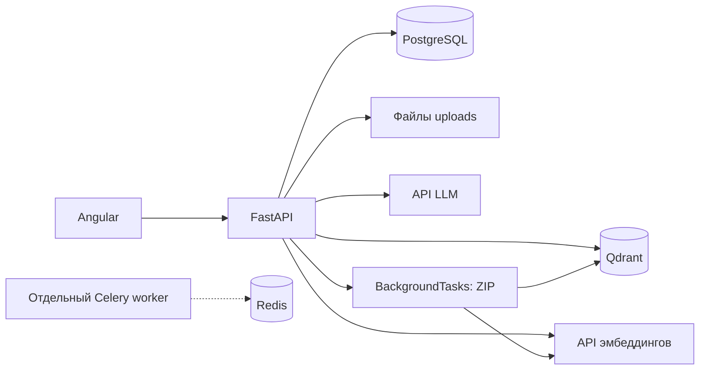

# Архитектура

Описание по исходникам на 24.10.2026.

Настройки и выполнение RAG находятся в одном backend. Celery/Redis присутствуют в инфраструктуре, но HTTP-загрузки не ставят задачи в Celery.

## Данные

| Сущность | Содержимое |
| --- | --- |
| `projects` | UUID, название, дата, настройки чанкинга, эмбеддингов, LLM, ключи/URL и промпт |
| `data_sources` | UUID, проект, имя/путь файла, статус, число чанков, ошибка |
| `chat_history` | Числовой ID, UUID проекта и сессии, роль, текст, дата |

Удаление проекта каскадно удаляет связанные SQL-записи. Файлы и коллекция Qdrant остаются. Удаление источника также затрагивает только SQL-запись.

Коллекция Qdrant: `project_<UUID с заменой дефисов на подчёркивания>`. Используется cosine distance; payload содержит `text` и `metadata` с `source` и `chunk_index`. Связи точки с `data_source_id` нет. `Document` получает новый UUID, поэтому повторная загрузка добавляет новые точки.

## Обработка одиночного файла

`api/upload.py:upload_single` сохраняет оригинал в `UPLOAD_DIR/<project_id>/<filename>`, парсит временную копию и разбивает текст. Создаётся SQL-источник со статусом `processing`, затем в рамках того же HTTP-запроса вычисляются эмбеддинги и выполняется upsert в Qdrant. Итоговый статус — `completed` или `failed`. Сбой векторизации может вернуть HTTP 200: клиент должен проверять поле `status`.

PDF обрабатывается pypdf без OCR. TXT читается как UTF-8 с поддержкой BOM и заменой некорректных символов. DOCX включает абзацы и строки таблиц. Рекурсивный splitter измеряет размер и перекрытие в символах. `split_by` и `extract_tables` в `process_file` не передаются, поэтому не меняют обработку. В частности, режим `tokens` не означает фактическое разбиение по токенам.

## ZIP

`upload_archive` сохраняет ZIP во временный каталог и возвращает 202 с `operation_id`. FastAPI BackgroundTasks запускает `_process_archive_full`: распаковка → парсинг → чанкинг → синхронные эмбеддинги → Qdrant. Неподдерживаемые файлы и ошибки парсинга попадают в `skipped_files`; нулевое число чанков также может завершиться как `completed`.

Статусы хранятся в словаре `_OPERATIONS` одного процесса, исчезают при перезапуске и не разделяются между workers. Для содержимого ZIP SQL-источники не создаются. Оригиналы удаляются вместе с временным каталогом после обработки.

Одноимённая функция `core/ingestion/pipeline.py:process_archive` только парсит/разбивает документы и возвращает чанки через словарь операций; действующий endpoint вызывает другую функцию — `_process_archive_full` из `api/upload.py`.

## Чат

Полный `/projects/{id}/chat` загружает SQL-историю сессии, векторизует вопрос, ищет до пяти чанков и вызывает LLM. В модель передаются системный промпт, первые 2000 символов контекста, история и вопрос. Два сообщения сохраняются в SQL. `sources` — уникальные имена файлов из найденных чанков без страниц и оценок релевантности.

Ошибка retrieval логируется, после чего генерация продолжается без контекста. Ошибка LLM возвращает 502. Отдельный `/chat/generate` принимает готовый контекст/историю, не выполняет поиск и не сохраняет диалог; `session_id` не используется.

## Расширение

Интерфейсы находятся в `core/*/base.py`, адаптеры регистрируются в `core/factories.py`. Новый формат требует парсера и записи в `PARSER_REGISTRY`. Новый провайдер — реализации интерфейса, регистрации и настройки builder-функции. Имена моделей в форме не добавляют поддержку протокола автоматически. Выбор модели `sentence-transformers/*` сейчас приводит к `NotImplementedError` в HuggingFace-адаптере.
